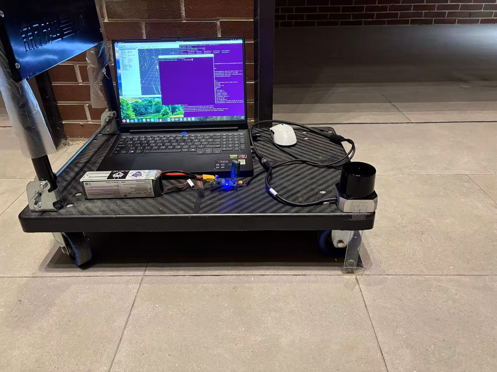
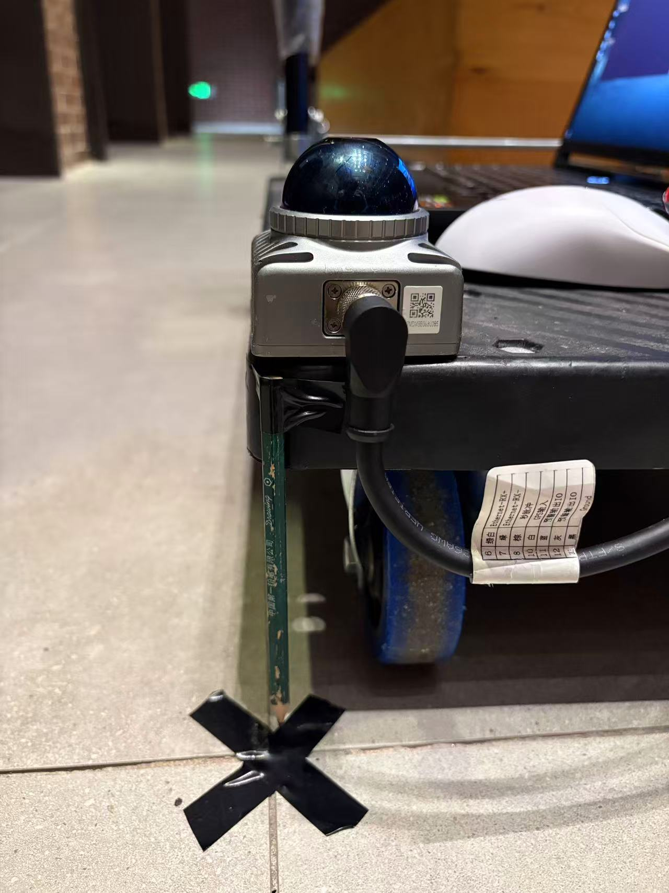
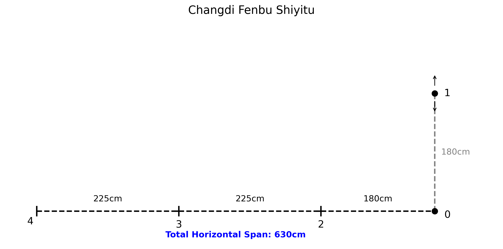
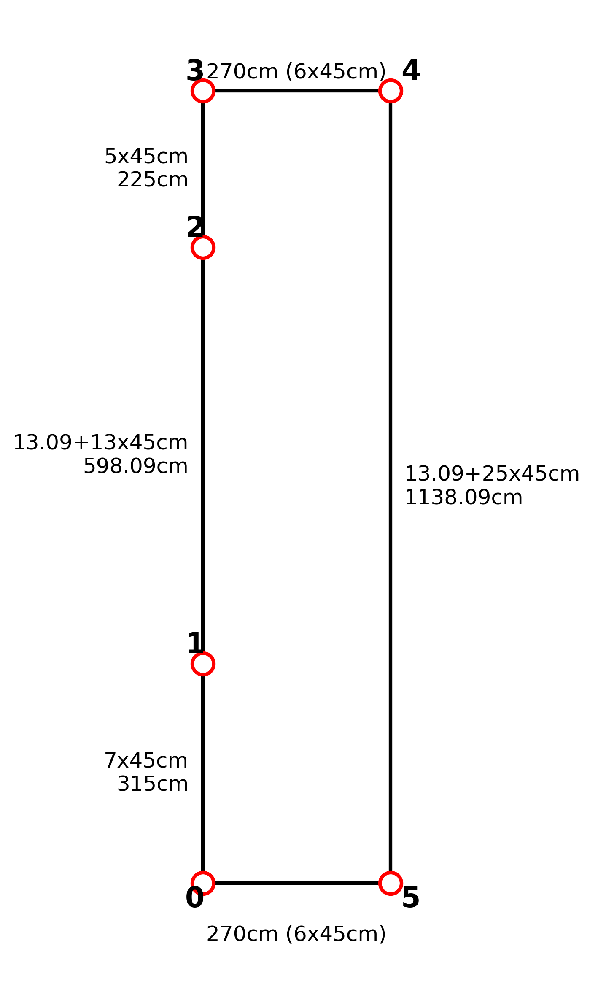
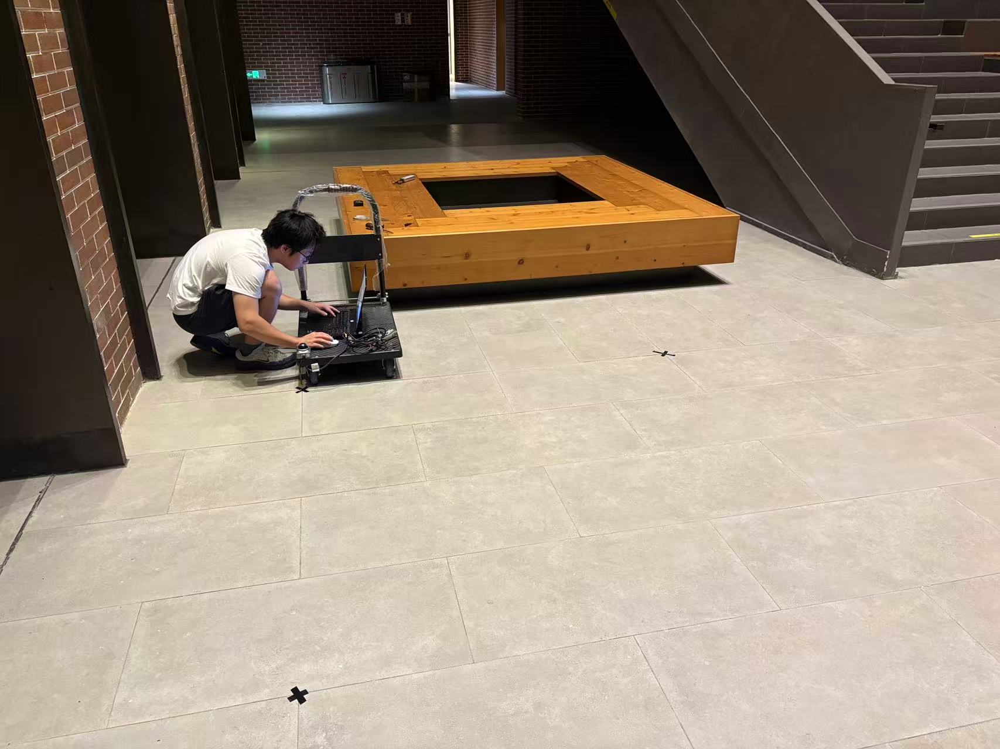
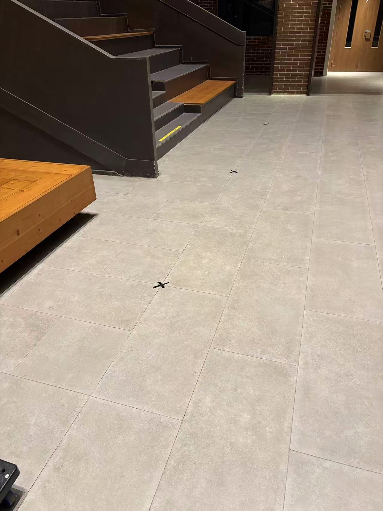

# MID-360s vs C01 —— 两颗雷达的实测对比

> 本文只讲硬件和数据本身的差别，算法结果见
> [02_四算法最终总结.md](02_四算法最终总结.md)。

**快速跳转**

| 想看什么 | 去哪 |
|---|---|
| **精度对比（一颗雷达比另一颗准多少）** | **[跳到第 6 节 · 精度对比](#6-精度对比8-个包同样-4-个算法)** |
| **8 个包怎么采的、每个包怎么跑** | [第 2 节 · 采集与运行协议](#2-这-8-个包是怎么来的怎么跑的) |
| 两颗雷达的规格差异 | [第 1 节 · 规格对照](#1-规格对照) |
| 怎么判断一份 bag 是哪颗雷达录的 | [第 3 节 · 实测数据对照](#3-实测数据对照从-bag-里量的) |
| 驱动要不要改、改哪一行 | [第 4 节 · 驱动层面的异同](#4-驱动层面的异同) |
| 外参怎么办 | [第 5 节 · 外参已确认](#5-imulidar-外参两颗雷达都已确认) |
| 跑算法时的速度差异 | [第 7 节 · 跑算法时的实际差异](#7-跑算法时的实际差异) |
| 一页速查（选哪个） | [第 8 节 · 一页速查](#8-一页速查) |

---

## 0. 一句话结论

| | Livox MID-360s | SKYLANDX C01 |
|---|---|---|
| 定位 | 成熟生态、文档全、社区移植多 | 点更密、俯仰视场更大、精度上限更高 |
| 驱动 | `livox_ros_driver2` | **同一套** `livox_ros_driver2`（UDP + Livox SDK2 协议）|
| 选型建议 | 要快速上手、要社区案例 → MID-360s | 要极致精度、能接受未知外参带来的调试成本 → C01 |

---

## 1. 规格对照

| 项 | MID-360s | C01 | 差异影响 |
|---|---|---|---|
| 激光波长 | 905 nm | 905 nm | — |
| 人眼安全 | Class 1 | Class 1 | — |
| 测距 | 40 m @10% / 70 m @80% | 40 m @10% / 70 m @80% | 相同 |
| **近处盲区** | 0.1 m | **0.05 m** | C01 能贴得更近 |
| **视场角** | 360° × 59°（−7°~+52°） | **360° × 65°（−20°~+45°）** | C01 往下多看 13°，地面/脚下信息多很多 |
| **点率** | 200,000 pts/s | **216,000 pts/s（双线）** / 108,000（单线） | C01 每帧多 8% |
| 角分辨率 | 0.2°（水平） | 0.15° / 水平、0.36° 垂直 | C01 水平更细 |
| 扫描方式 | 非重复 | 非重复（3 轴） | 相同 |
| 帧率 | 10 Hz | 10 Hz（最高 30 Hz） | 相同 |
| 内置 IMU | 200 Hz | 200 Hz（3 轴加速度 + 3 轴角速度） | 相同 |
| **工作电压** | **9~27 V** | **12~30 V DC** | C01 下限更高，9 V 档可能不启动 |
| 功率 | — | 最大额定 15 W | 空载会明显发热，可用来判断是否上电 |
| 防护 | IP67 | IP67 | 相同 |
| 重量 | 265 g | **420 g** | 支架承重要够 |
| 尺寸 | 较小 | 73 × 73.75 × 77.8 mm | — |

---

## 2. 这 8 个包是怎么来的、怎么跑的

### 2.1 采集平台与方式（8 个包都一样）

```
推着小车沿地面标记点走 → 到点停住 3~5 秒 → 走到下一个点
```



小车上装的是：笔记本（跑驱动 + 录包）、12 V 锂电池、雷达（右侧立着的黑色圆柱）。
碳纤维板 + 四个万向轮，走起来比手持稳。



雷达固定在板子边缘，下方就是停车点标记（黑色 X 胶带）。

航插线上贴着针脚标签，放大后是这样（和官方手册 §"M12 航空插头" 完全一致）：

| 针 | 线色 | 信号 |
|---|---|---|
| 6 | 绿白 | Ethernet-RX+ |
| 7 | 绿 | Ethernet-RX− |
| 8 | 棕 | 秒脉冲（PPS）|
| 10 | 白 | GPS 输入 |
| 11 | 蓝 | 预留输出 IO |
| 12 | 灰 | 预留输出 IO |
| 2 / 3 | 黑 | Ground |

> 这张标签在排查 C01 时很有用：它证明**手上这根确实是标准 Livox 航插一分三线**
> （1/9 红 = 电源 +，2/3 黑 = GND，4/5 = TX±，6/7 = RX±）。
> 那 C01 接上不亮就只剩两种可能：C01 的接插件针脚定义不同，或者 C01 本身有问题。

- **为什么要在每个点站住**：真值只有"停车点坐标"，没有逐帧真值。
  站住 3~5 秒，评测脚本才能靠「速度 < 0.08 m/s 且持续 > 2 s」把这段识别成静止段，
  再和卷尺量的坐标一一对应。
- **真值怎么来的**：卷尺量相邻标记点的距离，累加出坐标。
  每段估计误差 ±1 cm —— 这个量级已经和 GLIM 的误差同量级，是**评测方法的精度下限**。
- **点云格式**：全部用 `rviz_MID360_launch.py` 录，得到 `sensor_msgs/PointCloud2`
  （每点自带 float64 纳秒时间戳）。不是 `msg_` 那个 launch 的 `CustomMsg`。

### 2.2 两块场地、四条路线

**老场地**（室内货架仓库，1.80 × 6.30 m）



```
        P1 (0, 1.80)
         │  2.546 m
P0 ──────┼──────── P2 (-1.80, 0) ──── P3 (-4.05, 0) ──── P4 (-6.30, 0)
(0,0)   1.80 m         2.25 m              2.25 m
```

**新场地**（矩形，2.70 × 11.38 m）—— 这是 C01 的主场地



```
        P3 (0, 11.38) ─────── 2.70 m ─────── P4 (2.70, 11.38)
          │ 2.25 m                                  │
        P2 (0, 9.13)                                 │ 11.38 m
          │ 5.98 m                                  │
        P1 (0, 3.15)                                 │
          │ 3.15 m                                  │
        P0 (0, 0) ────────── 2.70 m ────────── P5 (2.70, 0)
```

现场实拍（地面上贴的黑色 X 胶带就是停车点标记）：





第二张照片里能看到贴在楼梯上的**黄色卷尺** —— 那就是量 2.25 m / 5.98 m 这些段长用的。

**命名规则：前两位是雷达，`01`/`02` 是 MID-360s，`03`/`04` 是 C01。**

| 包 | 雷达 | 网段 | 场地 | 走法 | 路径长 | 闭环 | 时长 | 点云帧数 | 大小 |
|---|---|---|---|---|---|---|---|---|---|
| `01_1` | **MID-360s** | 192.168.1.x | 老 | 0-1-2-3-4-0 | 15.15 m | 是 | 212 s | 2121 | 1.1 GB |
| `01_2` | **MID-360s** | 192.168.1.x | 老 | 0-1-2-3-4-0（重复第 2 次）| 15.15 m | 是 | 251 s | 2513 | 1.3 GB |
| `02_1` | **MID-360s** | 192.168.1.x | 老 | 0-2-3-4-1-0 | 14.65 m | 是 | 240 s | 2403 | 1.2 GB |
| `02_2` | **MID-360s** | 192.168.1.x | 老 | 0-2-3-4-1-0（重复第 2 次）| 14.65 m | 是 | 225 s | 2245 | 1.2 GB |
| `03_01` | **C01** | 192.168.100.x | 新 | 0-1-2-3-4-5-0 | 28.16 m | 是 | 194 s | 1938 | 1.1 GB |
| `03_02` | **C01** | 192.168.100.x | 新 | 0-5-4-3-2-1-0（**反着走**，起点没停）| 25.46 m | 否 | 235 s | 2347 | 1.3 GB |
| `04_01` | **C01** | 192.168.100.x | 老 | 0-2-3-4-1-0 | 14.65 m | 是 | 159 s | 1586 | 0.9 GB |
| `04_02` | **C01** | 192.168.100.x | 老 | 0-1-2-3-4-0（起点没停）| 13.35 m | 否 | 137 s | 1365 | 0.8 GB |

**几点说明：**

- **MID-360s 的 4 个包是「2 条路径 × 各走 2 次」** → 能算重复性（同一算法 4 次的极差）。
- **C01 的 4 个包是「新场地正/反 + 老场地两种路径」** → 探不同场地尺度下的表现，
  不构成重复性样本（每个组合只走 1 次）。
- `03_02` 和 `04_02` **起点没停**，所以是开放路径，只有 6 / 5 个停车点，闭合误差无意义。
- `03_02` 的走法是从轨迹反推出来的：停车点逐段腿长 11.38 / 2.70 / 2.25 / 5.98 / 3.15 m
  全部对上老场地真值，只是顺序倒过来。

### 2.3 每个包怎么跑（8 × 4 = 32 次运行）

每个 bag 都跑 **4 个算法**，一共 32 次：

| 算法 | 命令 | 回放倍率 | 原因 |
|---|---|---|---|
| GLIM | `12_run_glim_on_bag.sh` | — | 离线直接读 bag，不经 ROS 回放 |
| FAST-LIO2 | `05_run_fastlio_on_bag.sh` | 1.0（长包 0.7）| 1.0 时 `03_02` 中途发散 |
| Point-LIO | `23_run_pointlio_on_bag.sh` | **0.35** | 1.0 时只吃得下 21% 的帧，轨迹断在半路 |
| LIO-SAM | `17_run_liosam_on_bag.sh` | **0.7** | 1.0 时丢约 16% 的帧 |

```bash
# 例：一个 bag 跑四个算法
cd ~/slam_benchmark
BAG=rosbag/04_02; OUT=results/2026-11-02_C01

bash scripts/05_run_fastlio_on_bag.sh  $BAG $OUT/04_02_fastlio  --config c01_pc2.yaml --rate 0.7
bash scripts/23_run_pointlio_on_bag.sh $BAG $OUT/04_02_pointlio --rate 0.35
bash scripts/17_run_liosam_on_bag.sh   $BAG $OUT/04_02_liosam   --rate 0.7
bash scripts/12_run_glim_on_bag.sh     $BAG $OUT/04_02_glim
```

**每个算法用的配置文件**（这是最容易忽略、也最影响结果的一点）：

| 算法 | MID-360s 的包 | C01 的包 |
|---|---|---|
| FAST-LIO2 | `mid360_pc2.yaml` | **`c01_pc2.yaml`**（只改了 `blind: 0.5 → 0.1`）|
| Point-LIO | `pointlio_ws/.../mid360.yaml` | 同一份（没改）|
| LIO-SAM | `config/liosam_mid360.yaml` | 同一份（没改）|
| GLIM | `config/glim_livox/` | 同一份（没改）|

> 除了 FAST-LIO2 改了盲区，其余三个算法**在 C01 上沿用了 MID-360s 的参数**，
> 包括 `T_lidar_imu` 这个 MID-360s 的出厂外参。C01 的外参没拿到之前，
> 这一点曾是四份数据共同的不确定源，现已按官方值修正（详见[第 5 节](#5-imulidar-外参两颗雷达都已确认)）。

### 2.4 跑完怎么评

```bash
python3 scripts/14_eval_on_site.py <轨迹文件> \
    --site config/site_xxx.json \
    --stop-from <最干净的那条轨迹>
```

三件事必须做对，否则数字没意义：

1. **`--site` 指定场地真值**（5 份，见 [docs/02 第 2 节](02_四算法最终总结.md#2-评测方法)）；
2. **`--stop-from` 统一停车窗口** —— 否则不同噪声水平的算法会被自己的停车点检测误差带偏
   （Point-LIO 曾因此被只识别出 3/7 个点，误差虚高 60 倍）；
3. **一次只跑一个算法、一个 bag** —— 曾有并发回放污染了 `/livox/lidar`，
   把 LIO-SAM 的 0.4 cm 变成 3.7 cm。

---

## 3. 实测数据对照（从 bag 里量的）

| 指标 | MID-360s（`01_1`/`02_1`） | C01（`03_01`/`03_02`/`04_01`/`04_02`） |
|---|---|---|
| 每帧点数 | 19968 ~ 20064 | **21600 ~ 21888** |
| 折算点率 | 200 ~ 201 k pts/s | **215 ~ 219 k pts/s** |
| 俯仰角覆盖 | **−7.5° ~ +53.5°** | **−20.3° ~ +44.9°** |
| 点云频率 | 10.0 Hz | 10.0 Hz |
| IMU 频率 | 199.7 Hz | 199.7 Hz |
| 点云格式 | `sensor_msgs/PointCloud2`，`point_step=26` | 同 |
| `frame_id` | `livox_frame` | 同 |
| bag 体积 | ≈ 5.3 MB/s | ≈ 5.7 MB/s |

**这两条（点数 + 俯仰角）是判断「这份 bag 到底是哪颗雷达录的」的可靠指纹。**
不用看文件名、不用问人，量一下就知道。

### 自己量一遍

```bash
cd ~/slam_benchmark
/usr/bin/python3 - <<'PY'
import sqlite3, struct, math, glob
for b in ["rosbag/01_1", "rosbag/03_01"]:
    db = glob.glob(b + "/*.db3")[0]
    con = sqlite3.connect(f"file:{db}?mode=ro", uri=True)
    tid = con.execute("select id from topics where name='/livox/lidar'").fetchone()[0]
    d, = con.execute("select data from messages where topic_id=? order by timestamp limit 1", (tid,)).fetchone()
    ln = struct.unpack_from('<I', d, 12)[0]          # frame_id 长度
    h, w = struct.unpack_from('<II', d, 16 + ln)     # height, width
    n = h * w
    ps = next(c for c in range(13, 65) if 60 <= len(d) - n * c <= 400)
    blob = d[len(d) - 1 - n * ps:][1:]               # 跳过 1 字节尾部填充
    el = [math.degrees(math.atan2(z, math.hypot(x, y)))
          for x, y, z in (struct.unpack_from('<fff', blob, k) for k in range(0, n * ps, ps))
          if math.hypot(x, y) > 0.05]
    print(f"{b:14s} {n:6d} 点/帧  → {n*10/1000:.0f}k pts/s   俯仰 {min(el):.1f}° ~ {max(el):.1f}°")
    con.close()
PY
```

期望输出：

```
rosbag/01_1    20064 点/帧  → 201k pts/s   俯仰 -7.5° ~ 53.5°     ← MID-360s
rosbag/03_01   21696 点/帧  → 217k pts/s   俯仰 -20.3° ~ 44.9°    ← C01
```

---

## 4. 驱动层面的异同

**结论：两颗雷达说的是同一个协议，但网段不同、驱动可以不同。**

### 4.1 网段（两套，不要混）

两家的出厂/推荐网络配置**完全不在一个网段**，这是最容易卡住的一步：

| | MID-360s | C01（官方驱动默认） |
|---|---|---|
| 主机网卡 IP | **192.168.1.50/24** | **192.168.100.150/24** |
| 雷达 IP | **192.168.1.3** | **192.168.100.200** |
| 点云流向 | 192.168.1.3:56300 → .50:56301 | 192.168.100.200:56300 → .150:56301 |
| IMU 流向 | 192.168.1.3:56400 → .50:56401 | 192.168.100.200:56400 → .150:56401 |
| 端口号 | 56300 / 56301 / 56400 / 56401 | **完全相同** |
| 配置脚本 | `scripts/02_get_livox.sh --net` | 驱动自带的 `tool/setup_lidar_net.sh` |

只有 IP 不同，端口号和报文格式一模一样 —— 这也是为什么 C01 能被 `livox_ros_driver2` 驱动。

**换雷达必须一起换网段**，否则表现为「驱动起来了但一个包都收不到」。

### 4.2 C01 上还有一个二层陷阱

官方驱动 README 里明确写了这一条，值得单独记：

> 部分固件把**目的 MAC 写死**（例如 `11:22:33:44:55:66`），当它与网卡自身 MAC
> 不一致时，数据包会在二层被直接丢弃——现象是「网口灯亮、链路 up，但
> `rx_packets` 一直是 0」，驱动自然收不到任何数据。

这是比「IP 配错」更隐蔽的一种失败：`ip addr` 看着正常、`carrier=1`、`ping` 可能还不通，
但 `rx_packets` 永远是 0。官方驱动为此提供了一个脚本，会自动改网卡 MAC
（改不动就开混杂模式），并做 3 秒收包自检：

```bash
sudo bash tool/setup_lidar_net.sh <网卡名> 192.168.100.150
# 不指定网卡名时会自动挑一个 up 且不承载默认路由的接口
```

排查时先看这个：

```bash
ip -s link show <网卡名> | grep -A1 RX    # rx_packets 涨不涨
sudo tcpdump -i <网卡名> -nn udp port 56300
# 应看到 192.168.100.200.56300 > 192.168.100.150.56301
```

> 这和我们在 11 月 2 日遇到的 `carrier=0` 不是同一层的问题（那次是物理层没链上，
> 根因是供电），但「看着通了其实收不到」的表现形式很像，容易混。

### 4.3 两种驱动怎么选

| | `livox_ros_driver2` | 官方 `skylandx_ros_driver` |
|---|---|---|
| 支持雷达 | MID-360s + C01（协议兼容） | C01 + D03 |
| 话题 | `/livox/lidar` `/livox/imu` | `/skylandx/lidar` `/skylandx/imu` |
| `frame_id` | `livox_frame` | `skylandx_frame` |
| 点云字段 | x,y,z,intensity,**tag,line**,timestamp(纳秒) | x,y,z,intensity,timestamp(秒) |
| `point_step` | 26 | 24 |
| IMU 加速度单位 | **g**（模长 ≈ 1.0） | **m/s²**（已 ×9.81） |
| 无效点 | 全部保留 | 过滤（`tag` 低 6 位非零跳过）|
| 雷达 IP | 要写死进配置 | **自动识别**，只需配 `host_ip` |
| 依赖 | Livox SDK2 | 无（直接实现 UDP）|

**本项目的 8 个 bag 全部是 `livox_ros_driver2` 录的**（C01 的 4 个也是），
所以下面的配置示例都以它为准。如果改用官方驱动，四个算法的配置要动这些：

| 算法 | 要改什么 | 原因 |
|---|---|---|
| FAST-LIO2 | 只改话题名 | 有 `acc_avr * G / norm` 归一化，g 和 m/s² 都能吃 |
| Point-LIO | 只改话题名 | 同样有归一化 |
| GLIM | 话题名 + **`acc_scale: 9.80665 → 1.0`** | 它不归一化，按固定比例换单位 |
| LIO-SAM | 话题名 + **删掉 `line` 依赖** | 官方驱动没有 `line` 字段，`N_SCAN: 4` 会失效 |

> 注意：官方驱动 README 的 FAQ 还有一条：**C01 的扫描条纹是竖直的**。
> 依赖「同一扫描线内相邻点共面」的算法（如 LIO-SAM 的特征提取）可能需要适配。

### 4.4 用 `livox_ros_driver2` 驱动时的配置

**同一个工作区、同一套驱动，只改 IP 和设备类型。**

```
             ┌─ livox_ros_driver2 ─┐        ┌─ Livox SDK2 ─┐
 bag/实时 ──►│ lds_lidar + 解析配置 │───────►│ device_manager│──► UDP 56000/56301/56401
             └─────────────────────┘        └──────────────┘
```

相同的地方：

| 项 | 说明 |
|---|---|
| 协议 | UDP + Livox SDK2 报文，命令口 56000、点云 56301、IMU 56401 |
| 话题 | `/livox/lidar`（10 Hz）、`/livox/imu`（200 Hz） |
| 配置文件结构 | `lidar_summary_info` + 设备段名 + `lidar_configs[]` |
| 输出格式 | 两种 launch 二选一：`CustomMsg`（`msg_*`）或 `PointCloud2`（`rviz_*`）|

不同的地方：

| 项 | 怎么确定 |
|---|---|
| 雷达 IP | `python3 scripts/03_livox_discover.py` |
| **设备类型 `dev_type`** | 同上，输出里的 `设备类型=` |
| 配置里该写哪个段名 | `dev_type=9 → "MID360"`；`35 → "Mid360s"`；`40 → "Avia2"`；`41 → "Mid360l"` |
| 对应 launch | `dev_type=9 → msg_MID360_launch.py`；`35 → msg_MID360s_launch.py` |


### 4.5 要改哪几行（按雷达分）

配置文件结构两颗雷达完全一样，只有 **`host_net_info` 的 host IP** 和
**`lidar_configs[0].ip` 的雷达 IP** 这两类值不同：

```jsonc
// ~/livox_ws/src/livox_ros_driver2/config/MID360_config.json
{
  "lidar_summary_info": { "lidar_type": 8 },
  "MID360": {                      // ← 段名必须和 dev_type 对应
    "lidar_net_info": {            // 雷达侧端口（两颗雷达相同）
      "cmd_data_port": 56100, "push_msg_port": 56200,
      "point_data_port": 56300, "imu_data_port": 56400, "log_data_port": 56500
    },
    "host_net_info": {             // PC 侧端口 = 雷达侧 + 1（两颗雷达相同）
      "cmd_data_ip": "192.168.1.50",   // ★ MID-360s 用 .1.50；C01 用 .100.150
      "cmd_data_port": 56101,
      "point_data_ip": "192.168.1.50", // ★ 同上，四个 IP 一起改
      "point_data_port": 56301,
      "imu_data_ip": "192.168.1.50",   // ★ 同上
      "imu_data_port": 56401
    }
  },
  "lidar_configs": [
    { "ip": "192.168.1.3",         // ★ MID-360s 用 .1.3；C01 用 .100.200
      "pcl_data_type": 1, "pattern_mode": 0,
      "extrinsic_parameter": { "roll": 0, "pitch": 0, "yaw": 0, "x": 0, "y": 0, "z": 0 } }
  ]
}
```

两颗雷达各自的完整取值：

| 字段 | MID-360s | C01 |
|---|---|---|
| `cmd_data_ip` / `point_data_ip` / `imu_data_ip` | `192.168.1.50` | **`192.168.100.150`** |
| `lidar_configs[0].ip` | `192.168.1.3` | **`192.168.100.200`** |
| `--device`（段名） | `mid360` 或 `mid360s` | 复用同一套（协议兼容），按 `dev_type` 定 |

让脚本代劳（推荐）：它会写雷达 IP、写 PC 侧 IP、同步到 `install/`：

```bash
# MID-360s
bash scripts/02_get_livox.sh --lidar-ip 192.168.1.3 --device mid360s

# C01（网段不同，主机网卡要先改成 192.168.100.150）
bash scripts/02_get_livox.sh --lidar-ip 192.168.100.200 --device mid360
```

脚本的宿主 IP 是写死的 `192.168.1.50`，跑 C01 时用 `--host-ip` 覆盖（或跑之前先配好网卡）：

```bash
bash scripts/02_get_livox.sh --lidar-ip 192.168.100.200 --host-ip 192.168.100.150 --device mid360
```

> `extrinsic_parameter` 那六个 0 是**驱动层**的输出补偿，不是 IMU-雷达外参。
> 我们不改它，外参在各算法的配置里设（见[第 5 节](#5-imulidar-外参两颗雷达都已确认)）。

---

## 5. IMU↔LiDAR 外参（两颗雷达都已确认）

外参是这一整套评测里**最容易被忽略、但对结果影响最大**的一项。两颗雷达现在都有官方值了。

### 5.1 官方值

| | MID-360s | C01 |
|---|---|---|
| 来源 | 用户手册 §3.5 | 官方 ROS 驱动 README |
| IMU 在雷达坐标系下的位置 | **(11.0, 23.29, −44.12) mm** | **(18.90, 24.64, −53.5) mm**（参考值） |
| 旋转 | 轴向与点云坐标系相同（R = I） | 同（R = I） |

两者只差 1.4 mm（y）和 9.4 mm（z），所以之前「用 MID-360 的值当替身」这个近似
在方向上没错，量级上偏了不到 1 cm。

> C01 的数值官方标注为「参考值」而非「逐台标定值」。如果想要更好精度，
> 需要向厂商索取该台的标定文件。

### 5.2 换算到四个算法

这里有一个**极易搞错的地方**：不同算法对同一个物理量用相反的符号。

设 `t_lidar_imu` = IMU 在雷达系下的位置（就是上表那些数），
`t_imu_lidar` = 雷达原点在 IMU 系下的位置 = `−t_lidar_imu`（因为 R = I）。

| 算法 | 参数名 | 物理含义 | MID-360s | C01 |
|---|---|---|---|---|
| **GLIM** | `T_lidar_imu` | IMU 在雷达系下 | `[0.011, 0.02329, -0.04412, 0,0,0,1]` | `[0.0189, 0.02464, -0.0535, 0,0,0,1]` |
| **FAST-LIO2** | `extrinsic_T` | 雷达在 IMU 系下（取反） | `[-0.011, -0.02329, 0.04412]` | `[-0.0189, -0.02464, 0.0535]` |
| **Point-LIO** | `extrinsic_T` | 雷达在 IMU 系下（取反） | `[-0.011, -0.02329, 0.04412]` | `[-0.0189, -0.02464, 0.0535]` |
| **LIO-SAM** | `extrinsicTrans` | 雷达在 IMU 系下（取反） | `[-0.011, -0.02329, 0.04412]` | `[-0.0189, -0.02464, 0.0535]` |

**三个「取反」的算法代码里都是同一个式子**：

```cpp
// FAST-LIO / Point-LIO
point_imu = Lidar_R_wrt_IMU * point_lidar + Lidar_T_wrt_IMU;
// LIO-SAM
lidar2Imu = Pose3(Rot3::Identity(), Point3(extTrans.x(), extTrans.y(), extTrans.z()));
```

要把雷达系的点变到 IMU 系，加的平移必须是「雷达原点在 IMU 系下的位置」，
所以符号与 GLIM 相反。**搞反了不会报错，只会让精度悄悄变差。**

### 5.3 本项目修正了什么

在拿到 C01 官方驱动之前，配置里有三处问题，现已全部修正：

| 问题 | 影响 | 修正 |
|---|---|---|
| C01 四个算法都用 MID-360 的外参 | z 方向偏 9.4 mm、x 偏 7.9 mm | 新增 `config/glim_c01/`、`config/liosam_c01.yaml`、`c01_pc2.yaml`、Point-LIO `c01.yaml` |
| **Point-LIO 的符号写反了** | 杠杆臂变成 2 倍误差（z 方向 8.8 cm），静止时看不出，转动时才有 | `mid360.yaml` 改成 `[-0.011, -0.02329, 0.04412]` |
| **LIO-SAM 用 `[0,0,0]`**，忽略了整条杠杆臂 | 完全不做 IMU-雷达平移补偿 | MID-360 填 `[-0.011, -0.02329, 0.04412]` |

> Point-LIO 那个符号错误是读了官方驱动 README、回头核对源码才发现的。
> 修完重跑后 Point-LIO 在 MID-360s 上平均 **0.31 cm**（旧值 0.35 cm），
> 差别确实很小 —— 手持慢速走动角速度小，杠杆臂误差主要影响加速度投影，
> 量级本来就低。**但 C01 上的改善更明确**：`03_02` 的 GLIM 从 4.8 cm 降到 1.8 cm。

---

## 6. 精度对比（8 个包，同样 4 个算法）

老场地 1.80 × 6.30 m（13~15 m 路径）、新场地矩形 2.70 × 11.38 m（25~28 m 路径），
卷尺标定。**两颗雷达是各自独立采集，不是同一时刻的 AB 对比**，只能看量级。

外参已按两颗雷达各自的官方标定值统一修正，32 次运行 2026-11-05 一次性重跑，
所以下表是同一口径。

| 雷达 | bag | 路径长 | GLIM | Point-LIO | LIO-SAM | FAST-LIO2 |
|---|---|---|---|---|---|---|
| MID-360s | 01_1 | 15.15 m | 0.30 | **0.18** | 0.51 | 1.88 |
| MID-360s | 01_2 | 15.15 m | 0.41 | **0.37** | 0.52 | 1.93 |
| MID-360s | 02_1 | 14.65 m | **0.37** | 0.39 | 0.66 | 1.75 |
| MID-360s | 02_2 | 14.65 m | **0.23** | 0.29 | 1.37 | 2.04 |
| MID-360s | **平均** | — | 0.33 | **0.31** | 0.77 | 1.90 |
| C01 | 03_01 | 28.16 m | **4.71** | 7.19 | 4.92 | 8.07 |
| C01 | 03_02 | 25.46 m | 1.83 | 4.00 | **1.38** | 1.61 |
| C01 | 04_01 | 14.65 m | **0.52** | 0.62 | 1.08 | 1.77 |
| C01 | 04_02 | 13.35 m | 0.61 | **0.39** | 0.64 | **0.39** |
| C01 | **平均** | — | **1.92** | 3.05 | 2.00 | 2.96 |

（单位 cm，停车点定位 RMS。加粗 = 该行最好）

**能读出来的结论：**

1. **老场地（13~15 m）两颗雷达都能到 1 cm 以下**，最好的两组是 MID-360s 的
   `01_1` Point-LIO **0.18 cm** 和 C01 的 `04_02` Point-LIO **0.39 cm**。
   差别被卷尺真值的 ±1 cm 不确定度吃掉了 —— 这个量级探不到雷达差异。
2. **场地一变大，误差涨 3~20 倍，而且与雷达无关**：同一颗 C01 从
   老场地 0.39~1.77 cm 掉到新场地 1.38~8.07 cm。
   **没有任何数据表明 C01 在大场景更好。**
3. **换一条路线就能换冠军。** `03_01` GLIM 最好（4.71）、`03_02` 变成 LIO-SAM（1.38）、
   `04_01` 又是 GLIM（0.52）、`04_02` 是 Point-LIO / FAST-LIO2 并列（0.39）。
   8 个包里没有任何算法全胜。
4. **FAST-LIO2 在 MID-360s 上吃亏，在 C01 上很能打**：MID-360s 平均 1.90 cm
   是另外三个的 2.5~6 倍；到了 C01 老场地只有 0.39~1.77 cm，和第一名同档。
   它的在线外参估计 + C01 更密的点云是主要原因。

> C01 的 `04_02` 首轮 LIO-SAM 曾被并发回放污染（报 3.7 cm），隔离重跑后 0.4~0.6 cm。
> 本轮又踩了一次类似的坑：`04_01` 的 Point-LIO / LIO-SAM 在三路并行时被算力挤掉，
> 轨迹只覆盖 132/159 s 和 83/159 s，误差虚高到 61 cm 和 240 cm，隔离重跑才恢复。
> **教训：并行必须给不同 `ROS_DOMAIN_ID`，且跑完要核对轨迹覆盖率。**

---

## 7. 跑算法时的实际差异

| 项 | MID-360s | C01 | 处理办法 |
|---|---|---|---|
| 每帧点数 | 20 k | 21.7 k | — |
| **实时余量** | Point-LIO / LIO-SAM 勉强实时 | **跑不满实时** | Point-LIO `--rate 0.35`、LIO-SAM `--rate 0.7` |
| GLIM | 离线，不受影响 | 离线，不受影响 | — |
| FAST-LIO2 | 实时 | 大部分能实时，长包偶发发散 | 发散时降到 `--rate 0.7` |
| 近处点 | `blind: 0.5` 合适 | 盲区只有 5 cm，`blind: 0.1` 更合适 | `c01_pc2.yaml` |
| 配置文件 | `mid360.yaml` / `mid360_pc2.yaml` | `c01.yaml` / `c01_pc2.yaml`（本仓库提供 pc2 版） | — |

**为什么 C01 跑不满实时**：多 8% 的点解释不了一半的速度差，更可能是
65° 大视场让每帧的**空间跨度**变大（往下看到脚边地面），ikd-Tree / 体素
命中的节点数增加，单帧耗时不线性增长。要实时部署就得降采样
（`point_filter_num: 3~4`）。

---

## 8. 一页速查

| 你想… | 用哪个 |
|---|---|
| 快速跑通、要社区案例 | MID-360s |
| 要标定好的外参、省事 | MID-360s（出厂有值） |
| 要低近处盲区（贴地/贴墙） | C01（5 cm vs 10 cm） |
| 要更大的下视范围（脚下地形） | C01（−20° vs −7°） |
| 要对标论文里的 MID-360 结果 | MID-360s |
| 要极致精度上限 | 都行，先把外参标定好 |
| 要实时部署在嵌入式平台 | MID-360s（点数少、余量大） |

**判断 bag 是哪颗雷达录的**：看每帧点数（20064 → MID-360s，21696 → C01）
和俯仰角范围（−7°~53° → MID-360s，−20°~45° → C01）。
