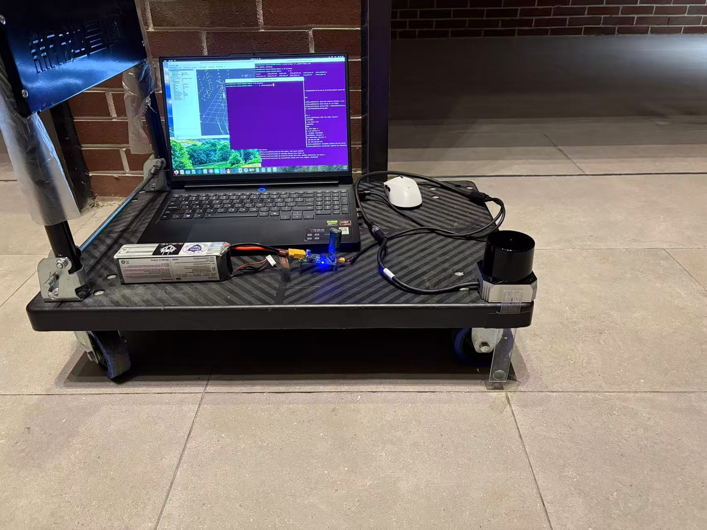

# 四种开源 SLAM 算法 · 最终总结

> 在**自建场地 + 自录数据**上，用卷尺标定的停车点做**绝对精度**评测。
> 两颗雷达（Livox MID-360s / SKYLANDX C01）× 四个算法 × 8 个 bag。
>
> 雷达硬件对比见 [01_MID360_vs_C01_雷达对比.md](01_MID360_vs_C01_雷达对比.md)，
> 手动启动方法见 [03_四算法手动启动与RViz.md](03_四算法手动启动与RViz.md)。



推车上的平台：笔记本跑驱动和录包、12 V 锂电池供电、雷达立在板子边缘。
每到一个地面标记点停 3~5 秒，靠这些静止段和卷尺真值算绝对误差。
平台和场地的细节见 [docs/01 第 2 节](01_MID360_vs_C01_雷达对比.md#2-这-8-个包是怎么来的怎么跑的)。

---

## 1. 四个算法是什么

| 算法 | 出处 | 核心思路 | 回环 | 输出话题 | 依赖复杂度 |
|---|---|---|---|---|---|
| **GLIM** | 日本产综研 AIST | 连续时间轨迹 + 体素平面匹配 ICP + 全局位姿图（子图级） | 有 | `traj_glim.txt`（离线直接写文件） | 注意：高（GTSAM + gtsam_points + CUDA，5 层） |
| **Point-LIO** | 港大 MARS | **逐点** IEKF，在 IMU 速率上更新（不是帧式），能扛剧烈运动 | 无 | `/aft_mapped_to_init` | 注意：低 |
| **LIO-SAM** | MIT / 港大（MID-360 移植版） | 特征提取（角点/平面）+ 因子图 + 回环检测 | 有 | `/lio_sam/mapping/odometry` | 注意：中 |
| **FAST-LIO2** | 港大 MARS | 帧式紧耦合 IEKF + ikd-Tree（增量地图） | 无 | `/Odometry` | 注意：低 |

装在哪：

| 算法 | 工作区 | 可执行文件 |
|---|---|---|
| GLIM | `~/glim_ws` | `install/glim_ros/lib/glim_ros/glim_rosbag`（离线）、`glim_rosnode`（在线）|
| Point-LIO | `~/pointlio_ws` | `lib/point_lio/pointlio_mapping` |
| LIO-SAM | `~/liosam_ws` | `lib/lio_sam/lio_sam_{imuPreintegration,imageProjection,featureExtraction,mapOptimization}` |
| FAST-LIO2 | `~/lio_ws` | `lib/fast_lio/fastlio_mapping` |

### 各自的坑（接入时真实踩过的）

| 算法 | 坑 | 修法 |
|---|---|---|
| **GLIM** | 需要 GTSAM **no-tbb** 版，ABI 不兼容会运行时报错 | 用 `scripts/10` 记录的方式装（见 `~/glim_ws`）|
| **Point-LIO** | 官方**只有 ROS 1 版** | 本项目做了 ROS 2 移植（catkin→ament、45 处时间 API、TF→tf2、`livox_ros_driver`→`livox_ros_driver2`）|
| **LIO-SAM** | 只订阅 `livox_ros_driver2/msg/CustomMsg`；bag 是 `PointCloud2` 时**静默收不到** | 起 `scripts/16_pc2_to_custom.py` 转换 |
| **LIO-SAM** | `~/.local/lib` 必须排在 `LD_LIBRARY_PATH` 最前，否则命中 `/usr/local` 的旧 GTSAM，报 `libboost_serialization.so.1.82.0: not found` | `export LD_LIBRARY_PATH="$HOME/.local/lib:$LD_LIBRARY_PATH"` |
| **FAST-LIO2** | 上游 `mid360_handler` 用 yaw 变化反推每点时间，公式只对**重复扫描**成立 | 打 `patches/0001-fastlio-mid360-point-timestamp.patch` |
| **全部** | 本机 `python3` 是 conda 3.13，跑不了 ROS `rclpy` | ROS 相关 `.py` 一律 `/usr/bin/python3`，或先剔掉 conda 的 PATH |

---

## 2. 评测方法

```
bag ──► 算法 ──► Odometry 话题 ──► TUM 轨迹(traj.txt)
                                      │
                                      ▼
                        ① 找静止段（速度 < 0.08 m/s 且持续 > 2 s）
                        ② 静止段位置相近则合并（< 10 cm）→ 停车点
                        ③ 与卷尺真值停车点一一对应
                        ④ SE(2) Umeyama 对齐（旋转 + 平移 + 尺度）
                        ⑤ 输出：点位误差 / 段长尺度偏差 / 闭合误差
```

工具：`scripts/traj_recorder.py`（任意话题 → TUM）、
`scripts/14_eval_on_site.py`（绝对精度评测）。

### 指标定义

| 指标 | 定义 | 怎么看 |
|---|---|---|
| **点位 RMS** | 所有停车点位置误差的均方根（cm） | **主指标**，越小越好 |
| 点位最大 | 最坏那个停车点（cm） | 看稳定性 |
| 尺度偏差 | Umeyama 得到的最优尺度 − 1（%） | 里程计尺度准不准 |
| 闭合误差 | 走一圈后首尾距离（cm） | 累积漂移；开放路径无意义 |
| 漂移率 | 点位 RMS ÷ 路径长（cm/m） | 跨路径长可比 |

### 注意：方法学：必须共用同一组停车时间窗

不同算法静止时的输出噪声差很多（GLIM 单步 0.04 cm，Point-LIO 0.46 cm）。
同一个「速度 < 0.08 m/s」阈值会**系统性惩罚噪声大的算法** ——
Point-LIO 因此曾被只识别出 3/7 个停车点，误差算出来虚高 60 倍。

所以评测时**一律用 `--stop-from`，拿最干净的那条轨迹定停车时刻**：

```bash
python3 scripts/14_eval_on_site.py <待测轨迹> \
    --site config/site_xxx.json \
    --stop-from <最干净的那条轨迹>
```

「人什么时候站住了」是**数据本身的属性，与算法无关** —— 只有这样跨算法才可比。

---

## 3. 结果：MID-360s（4 个 bag，2 条路径 × 2 次）

> 全部 32 次运行已于 2026-11-05 按修正后的外参重跑，本节与下一节是同一口径。
> 详见 [`results/2026-11-05_外参修正/README.md`](../results/2026-11-05_外参修正/README.md)。

场地：1.80 × 6.30 m，路径 01 = 0-1-2-3-4-0（15.146 m），路径 02 = 0-2-3-4-1-0（14.652 m）。

### 点位 RMS（cm）

| 算法 | 01_1 | 01_2 | 02_1 | 02_2 | **平均** |
|---|---|---|---|---|---|
| GLIM | 0.30 (2) | 0.41 (2) | 0.37 (1) | 0.23 (1) | **0.33** (2) |
| Point-LIO | 0.18 (1) | 0.37 (1) | 0.39 (2) | 0.29 (2) | **0.31** (1) |
| LIO-SAM | 0.51 (3) | 0.52 (3) | 0.66 (3) | 1.37 (3) | **0.77** (3) |
| FAST-LIO2 | 1.88 | 1.93 | 1.75 | 2.04 | **1.90** (4) |

> `(1)` `(2)` `(3)` = 该列（同一个包内）四个算法里的第 1 / 2 / 3 名。

### 闭合误差（cm）

| 算法 | 01_1 | 01_2 | 02_1 | 02_2 | **平均** |
|---|---|---|---|---|---|
| GLIM | 0.56 (2) | 0.49 (1) | 0.69 (2) | 0.02 (1) | **0.44** (2) |
| Point-LIO | 0.33 (1) | 0.53 (2) | 0.50 (1) | 0.38 (2) | **0.43** (1) |
| LIO-SAM | 0.78 (3) | 0.58 (3) | 0.79 (3) | 3.01 (3) | **1.29** (3) |
| FAST-LIO2 | 6.20 | 6.20 | 5.42 | 5.95 | **5.94** (4) |

### 尺度偏差（%）

| 算法 | 01_1 | 01_2 | 02_1 | 02_2 | **平均** |
|---|---|---|---|---|---|
| GLIM | 0.064 (3) | 0.018 (1) | 0.037 (3) | 0.029 (1) | **0.037** (1) |
| Point-LIO | 0.067 | 0.062 | 0.025 (2) | 0.030 (2) | **0.046** (2) |
| LIO-SAM | 0.029 (1) | 0.050 (3) | 0.024 (1) | 0.139 | **0.061** (3) |
| FAST-LIO2 | 0.034 (2) | 0.023 (2) | 0.176 | 0.092 (3) | **0.081** (4) |

### 一页汇总

| 算法 | 回环 | 点位 RMS | 点位最大 | 尺度偏差 | 闭合误差 | 漂移率 | 稳定性(极差) |
|---|---|---|---|---|---|---|---|
| GLIM | 有 | 0.33 cm | 0.53 cm | 0.037% | 0.44 cm | 0.022 cm/m | 0.17 cm |
| Point-LIO | 无 | 0.31 cm | 0.46 cm | 0.046% | 0.43 cm | 0.021 cm/m | 0.21 cm |
| LIO-SAM | 有 | 0.77 cm | 1.30 cm | 0.061% | 1.29 cm | 0.052 cm/m | 0.86 cm |
| FAST-LIO2 | 无 | 1.90 cm | 3.57 cm | 0.081% | 5.94 cm | 0.128 cm/m | 0.29 cm |

---

## 4. 结果：C01（4 个 bag，2 个场地）

| bag | 场地 | 路线 | 路径长 | 时长 |
|---|---|---|---|---|
| `03_01` | 新场地（矩形 2.70 × 11.38 m） | 0-1-2-3-4-5-0（正向，闭环） | 28.16 m | 194 s |
| `03_02` | 同上 | 0-5-4-3-2-1-0（**反向**，起点不停） | 25.46 m | 235 s |
| `04_01` | 老场地 | 路径 02：0-2-3-4-1-0（闭环） | 14.65 m | 159 s |
| `04_02` | 老场地 | 路径 01：0-1-2-3-4-0（起点不停） | 13.35 m | 137 s |

| 包 | 算法 | 点位 RMS | 点位最大 | 闭合误差 | 尺度偏差 |
|---|---|---|---|---|---|
| **03_01** | **GLIM** | **4.7 cm** | 7.0 cm | 6.7 cm | -1.17% |
|  | LIO-SAM | 4.9 cm | 8.2 cm | 1.9 cm | -0.93% |
|  | Point-LIO | 7.2 cm | 11.2 cm | 0.9 cm | -1.67% |
|  | FAST-LIO2 | 8.1 cm | 13.7 cm | 7.5 cm | -1.48% |
| **03_02** | **LIO-SAM** | **1.4 cm** | 2.2 cm | — | +0.06% |
|  | FAST-LIO2 | 1.6 cm | 2.1 cm | — | +0.01% |
|  | GLIM | 1.8 cm | 3.0 cm | — | +0.21% |
|  | Point-LIO | 4.0 cm | 5.8 cm | — | +0.29% |
| **04_01** | **GLIM** | **0.5 cm** | 0.9 cm | 1.5 cm | +0.01% |
|  | Point-LIO | 0.6 cm | 0.9 cm | 1.1 cm | +0.11% |
|  | LIO-SAM | 1.1 cm | 1.7 cm | 2.1 cm | +0.00% |
|  | FAST-LIO2 | 1.8 cm | 2.9 cm | 4.1 cm | +0.30% |
| **04_02** | **Point-LIO** | **0.4 cm** | 0.5 cm | — | +0.03% |
|  | FAST-LIO2 | 0.4 cm | 0.6 cm | — | +0.02% |
|  | GLIM | 0.6 cm | 0.9 cm | — | -0.08% |
|  | LIO-SAM | 0.6 cm | 1.1 cm | — | +0.03% |

> 开放路径（03_02 / 04_02）起点没停，不构成闭环，闭合误差无意义。
>
> 四算法 8 包总平均：GLIM **1.12 cm** · LIO-SAM 1.39 cm · Point-LIO 1.68 cm · FAST-LIO2 2.43 cm。
>
> **和旧版差异最大的三个变化**：`03_02` 的 GLIM 4.8 → **1.8 cm**（外参修正带来的最大改善）、
> `03_02` 的 LIO-SAM 1.9 → 1.4、`04_01` 的 LIO-SAM 1.4 → 1.1。
>
> `03_01` 那一组的变化另有原因，不是外参 —— 是**评测脚本的 bug**：
> `--stop-from` 在参考轨迹上找停车点时没有重试机制（各算法自己检测时有），
> 03_01 的参考轨迹要放宽 `min_dur` 到 0.6 s 才凑够 7 个停车点，旧版只找到 6 个
> 就退回各自检测，于是停车点与真值**错位配对**，误差虚高到 400 cm 以上。
> 现已给 `--stop-from` 加上同样的重试，并用**对齐尺度自校验**（偏离 1 超 3% 就继续换参数）。

### C01 上的回放倍率（重要）

| 算法 | 倍率 | 不降速会怎样 |
|---|---|---|
| GLIM | — | 离线读 bag，不受影响 |
| FAST-LIO2 | 1.0（长包用 0.7）| 03_02 在 1.0 时中途发散 |
| LIO-SAM | **0.7** | 1.0 时丢约 16% 帧 |
| Point-LIO | **0.35** | 1.0 时只处理 21% 的帧，轨迹断在半路 |

---

## 5. 跨雷达、跨场景的总规律

| 场景尺度 | 最好的成绩 | 最差的成绩 |
|---|---|---|
| 老场地 13~15 m（两颗雷达都有，8 个组合） | 0.18 cm（`01_1` Point-LIO） | 2.04 cm（`02_2` FAST-LIO2） |
| 新场地 25~28 m（只有 C01，2 个包） | 1.38 cm（`03_02` LIO-SAM） | 8.07 cm（`03_01` FAST-LIO2） |

**四条能站得住的结论：**

1. **回环不是分水岭。** Point-LIO 没有任何回环检测，MID-360s 闭合误差 0.43 cm，
   比带闭环的 GLIM（0.44 cm）还略好，也远好于 LIO-SAM（1.29 cm）。
   同为零回环，FAST-LIO2 的闭合误差 5.94 cm 是 Point-LIO 的 **14 倍**。
   → **决定精度的是底层估计器质量，不是有没有回环。**
2. **场地面积比雷达型号更影响误差。** 同一颗 C01，老场地 0.39~1.77 cm，
   新场地 1.38~8.07 cm。面积翻倍、结构更空旷，误差涨 3~20 倍。
3. **没有一劳永逸的排名。** 新场地正向 GLIM 最好（4.7 cm）、FAST-LIO2 最差（8.1 cm）；
   反向却变成 LIO-SAM 最好（1.4 cm）。老场地 `04_01` 是 GLIM（0.5 cm）、
   `04_02` 是 Point-LIO / FAST-LIO2 并列（0.4 cm）。**换路线就能换冠军。**
4. **尺度都很准。** MID-360s 的 16 次里 |尺度偏差| 全部小于 0.18%，
   走 15 m 长度误差不到 3 cm；误差主要来自形状畸变和航向漂移，不是尺度。

---

## 6. 选型指南

| 你的需求 | 推荐 | 理由 |
|---|---|---|
| 要最高精度、能接受重依赖 | **GLIM** | 8 包总平均 1.12 cm 最好，尺度最准（0.037%），带回环 |
| 要抗剧烈运动（手持/无人机/机器狗） | **Point-LIO** | 逐点 IEKF，IMU 速率更新，MOV 下不崩 |
| 要部署简单、依赖少、能实时 | **FAST-LIO2** | 只依赖 PCL/Eigen，一份 yaml 就能跑 |
| 要回环但算力受限 | **LIO-SAM** | 因子图比 GLIM 轻，回环确实有效（但稳定性最差）|
| 要绝对可靠的重复性 | **Point-LIO** | 4 次运行极差 0.21 cm，最稳 |
| 完全不想折腾环境 | **FAST-LIO2** | 依赖最浅；GLIM 的 5 层依赖能把人逼疯 |

**反直觉的一条**：LIO-SAM 精度中等（0.77 cm）但**重复性最差**（MID-360s 4 次极差 0.86 cm，
`02_2` 那一次直接飙到 1.37 cm，是其余三次的两倍多）。原因大概率是它的回环检测
在某些走法下误匹配。相比之下 Point-LIO 极差只有 0.21 cm。

---

## 7. 复现主流程

```bash
cd ~/slam_benchmark

# (1) 录包（或已有 bag 放 rosbag/ 下）
bash scripts/26_record_bag.sh <包名>

# (2) 查看 bag 是什么格式（决定用哪个算法配置）
ros2 bag info rosbag/<包名> | grep livox/lidar

# (3) 跑算法（一条命令版；手动逐步版见 docs/03）
#     包名 01_/02_ 会自动用 MID-360s 的外参配置，03_/04_ 自动用 C01 的，
#     不用再手动指定 --config / --params
bash scripts/05_run_fastlio_on_bag.sh  rosbag/<包名> results/<日期>/<包名>_fastlio
bash scripts/23_run_pointlio_on_bag.sh rosbag/<包名> results/<日期>/<包名>_pointlio --rate 0.35
bash scripts/17_run_liosam_on_bag.sh   rosbag/<包名> results/<日期>/<包名>_liosam   --rate 0.7
bash scripts/12_run_glim_on_bag.sh     rosbag/<包名> results/<日期>/<包名>_glim

# (4) 评测（必须带 --stop-from）
python3 scripts/14_eval_on_site.py results/<日期>/<包名>_pointlio/traj.txt \
    --site config/site_xxx.json \
    --stop-from results/<日期>/<包名>_fastlio/traj.txt
```

**全量重跑**（8 包 × 4 算法）有现成脚本，支持断点续跑：

```bash
bash scripts/29_rerun_all.sh                    # 32 次，约 2~3 小时
bash scripts/29_rerun_all.sh --only c01         # 只跑 C01 的 4 个包
bash scripts/29_rerun_all.sh --dry              # 只看计划
bash scripts/29_rerun_all.sh --domain 11        # 并行时用独立 ROS_DOMAIN_ID

python3 scripts/30_eval_all.py                  # 自动挑停车窗口，一次评完 32 条
```

> 并行跑多个组合时**必须**给每一路不同的 `ROS_DOMAIN_ID`，
> 否则四个算法共用的 `/livox/lidar` 会串数据。并且跑完要核对
> **轨迹时长是否覆盖整个 bag** —— 覆盖不足说明算法被算力挤掉了。

场地真值文件：

| 文件 | 用途 |
|---|---|
| `config/site_mid360_demo.json` | 老场地路径 01（0-1-2-3-4-0，闭环）|
| `config/site_mid360_demo_path2.json` | 老场地路径 02（0-2-3-4-1-0，闭环）|
| `config/site_mid360_path1_open.json` | 老场地路径 01，起点不停（5 个停车点）|
| `config/site_c01_rect.json` | 新场地正向 0-1-2-3-4-5-0（7 个停车点）|
| `config/site_c01_rect_rev_open.json` | 新场地反向 0-5-4-3-2-1-0，起点不停（6 个）|

---

## 8. 当前局限（写论文/汇报要提）

1. **真值只有停车点**，没有逐帧真值（无 mocap / 无全站仪），
   所以算不出 RTE、算不出逐帧 ATE。
2. **真值不确定度约 ±1 cm/段** —— 和 GLIM/Point-LIO 的误差同量级，
   小场景里已经探不到算法差异。**这也是老场地排名不能当真结论的原因。**
3. **C01 的外参是厂商给的「参考值」**，不是自己标出来的。
   两颗雷达现在都有确定值并按它统一跑过（见
   [docs/01 第 5 节](01_MID360_vs_C01_雷达对比.md)），但 C01 建议自己再标一次。
4. **样本量小**：MID-360s 4 包、C01 4 包，都只有单次采集，
   重复性结论只对 MID-360s 的 4 次有效。
5. **C01 上跑不满实时**，Point-LIO 要 0.35 倍速 —— 说明当前实现不能直接上嵌入式平台。
6. **并行跑会互相抢算力。** 本轮 04_01 的 Point-LIO / LIO-SAM 在三路并行时被挤掉，
   轨迹只覆盖 132/159 s 和 83/159 s，误差虚高到 61 cm 和 240 cm，隔离重跑才恢复。
   并行时必须给每一路不同的 `ROS_DOMAIN_ID`，并且**核对轨迹覆盖率**。
